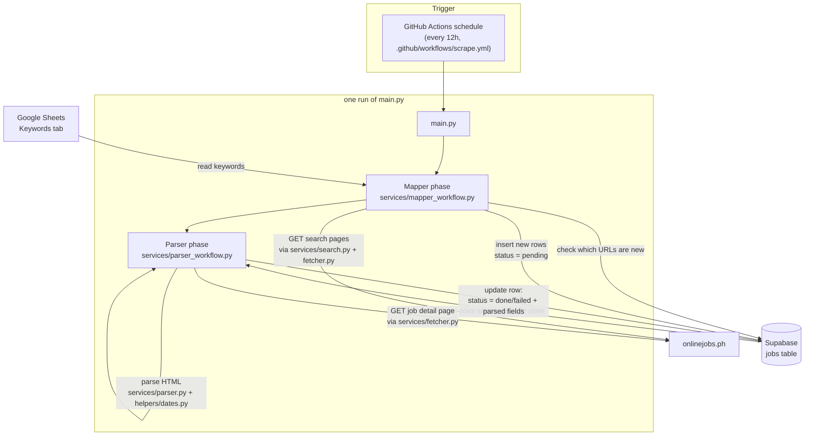

# Architecture

## Overview

One process (`main.py`), triggered by a scheduled GitHub Actions workflow every 12 hours. No API, no persistent server — the runner checks out the repo, does its work, exits.

## Phases

**Mapper** (`services/mapper_workflow.py`)
- Reads keywords from the Google Sheet (`services/sheets.py`).
- Searches onlinejobs.ph per keyword (`services/search.py`), paginated up to `MAX_PAGE_PER_KEYWORD`.
- Unions all links found, checks Supabase for which URLs are already known (`services/db.filter_new_urls`).
- Inserts only new URLs, `status = pending`.

**Parser** (`services/parser_workflow.py`)
- Pulls rows where `status != done` (covers `pending` and `failed` — failed rows retry every run), capped at `MAX_PARSE_PER_RUN`.
- Fetches each job's detail page live (`services/fetcher.py`) — no raw HTML is carried over from the mapper phase; the parser does its own network call.
- Parses the page (`services/parser.py`), converts the site's date string to a timestamp (`helpers/dates.py`).
- Writes the full result back to that row in one update: `status = done` + all parsed columns, or `status = failed` + `error_message` on any exception.

## Why this shape

- **Single table, two statuses, one process** — `pending`/`done`/`failed` on one `jobs` row is the whole state machine. No message queue, no second service, no separate scheduling for the two phases — they just run one after another in the same cron invocation.
- **Supabase over Google Sheets for job storage** — no per-cell size limit (Sheets caps a cell at 50,000 chars; raw job-detail HTML runs close to that), and this is explicitly meant to be the datastore this scales on.
- **Google Sheets kept for keyword input only** — non-technical, editable without a deploy.
- **5s delay before every request to onlinejobs.ph** — required by its `robots.txt` (`Crawl-delay: 5`), applied uniformly whether it's a search-page request (mapper) or a job-detail-page request (parser).
- **No headless browser** — onlinejobs.ph is server-rendered; search works via a plain `GET` with a `jobkeyword` query param, and job listings are present in the raw HTML. Plain `requests` + `BeautifulSoup` is enough.
- **Cron, not an API** — this is an internal data pipeline, not a request-response service, so a scheduled GitHub Actions workflow fits directly: no server to keep warm, no timeout to engineer around, no hosting cost (GitHub Actions' free tier covers this run's minutes easily). An API wrapper (e.g. for Apify or direct HTTP use) is a separate, later concern — `services/search.py`, `services/fetcher.py`, and `services/parser.py` have no framework dependency, so they're reusable as-is if that happens.
- **GitHub Actions over Render** — Render has no free tier for Cron Jobs (always bills per-minute compute); GitHub Actions' schedule trigger does the same job at no cost for this run volume.
